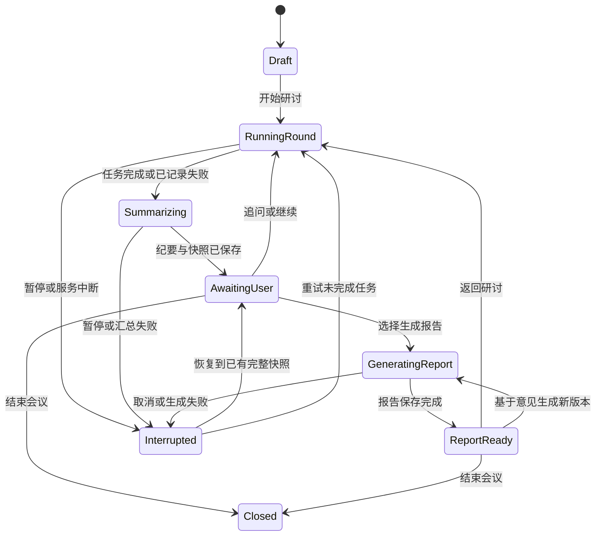

# 人机协同研讨与报告生成设计方案

建议将论坛建设为由用户主持决策、多个智能体分工研讨的报告工作台。每轮完成独立分析、交叉质询和汇总后暂停，由用户选择生成报告、定向追问或调整分析范围。报告基于用户选定的讨论快照生成，主要结论关联证据，并保留分歧与数据缺口。

本文为待实施的设计方案。第 1 节描述代码现状，其余部分均为建议设计，不代表功能已经上线。目标是提高报告的需求匹配、事实支持和观点覆盖质量；是否改善需要通过第 10 节的实验验证。

## 1. 现有基础与改造位置

当前论坛具备主持人调用与日志展示，但尚不具备本方案所定义的轮次、人工决策节点和版本化讨论记录。

| 已有模块 | 核对到的实现 | 本方案的复用方式 |
| --- | --- | --- |
| [ForumEngine/monitor.py](ForumEngine/monitor.py) | 读取三个引擎日志，发言缓冲达到 5 条时触发主持发言 | 保留旧模式；新论坛由显式轮次状态驱动 |
| [ForumEngine/llm_host.py](ForumEngine/llm_host.py) | 主持模型解析日志并生成发言 | 复用模型配置和调用基础，增加结构化议程与汇总接口 |
| [QueryEngine/agent.py](QueryEngine/agent.py) | `research()` 执行结构规划、分段检索、反思、报告生成 | 提取有预算限制的单轮分析入口，复用检索与总结能力 |
| [singleAgent/pipeline.py](singleAgent/pipeline.py) | 已有讨论和正式报告路径切换 | 参考会话与取消机制，不能直接等同于多人多智能体会议 |
| [task_event_bus.py](task_event_bus.py) | 任务事件编号、内存历史与 SSE 订阅 | 复用推送形式，增加持久化与重连补发 |
| [ReportEngine/agent.py](ReportEngine/agent.py) | `generate_report()` 接受分析材料、论坛文本、模板与报告 ID | 用会议快照构建输入，复用章节生成、DocumentIR 和渲染 |
| [templates/index.html](templates/index.html) | 主站展示与组件交互 | 新增研讨工作台入口 |

主站报告就绪检查当前依赖三个目录新增文件，再选取最新文件。本方案的论坛路径应直接读取会议快照，不依赖这一就绪检查。原有一键分析可以作为兼容入口保留。

## 2. 参与角色与职责

用户掌握议题、追问方向和报告生成时机。智能体提供证据与分析，主持智能体负责组织议程和说明分歧。

| 角色 | 职责 | 每轮应交付的内容 |
| --- | --- | --- |
| 用户／会议主席 | 明确问题、补充背景、质询、调整关注点、决定出报告 | 问题、约束、材料或操作指令 |
| 事实研究智能体 | 查询事件经过、公开文件、政策条文及时间线 | 有来源的事实、证据冲突与待核实项 |
| 媒体观察智能体 | 比较媒体议题、报道差异与叙事 | 媒体观点及来源，避免将报道直接当作民意 |
| 舆情数据智能体 | 分析实际帖子、评论和样本分布 | 样本范围、统计结果和代表性限制 |
| 主持智能体 | 拆解问题、分配任务、提出质询、汇总并推荐下一步 | 共识、分歧、问题覆盖、下一轮候选任务 |
| 报告编写智能体 | 根据选定快照组织报告 | 有引用的正文、方案比较、局限与待核实事项 |

最小版本复用 Query、Media、Insight、Forum 和 Report。政策影响、可行性与风险作为议程维度分配给现有角色，并通过交叉质询处理。只有实验显示某类问题长期缺失时，再增加独立风险审查角色，避免增加重复调用。

没有本地舆情数据时，舆情智能体应明确输出“无可分析样本”，并结束本轮任务。用户仍可继续研讨公开资料；报告说明数据范围。系统不生成虚构评论或公众支持率。

同一模型扮演多个角色并不产生相互独立的专家判断。多个智能体引用同一篇报道也不构成多源验证。主持人应按原始来源归并证据，不按发言人数决定事实真假。

页面中的“分析说明”包含结论、可核验依据、适用条件和不确定性。它是面向用户撰写的论证摘要，不展示或要求模型内部逐字推理轨迹，也不把运行日志包装成思考过程。

## 3. 用户交互流程

### 3.1 发起研讨

用户输入事件和希望解决的问题，可补充时间范围、参考材料、关注对象与报告用途。例如，议题可以聚焦某项公共服务政策调整的影响、实施条件和风险。

系统先展示一份简短议程草案和可用数据源。明确的任务可直接进入首轮，用户可随时修改；只有范围歧义会改变任务内容时才询问。论坛在开始分析时打开，展示角色与状态。

### 3.2 完成一轮讨论

一轮以共同的问题清单和指令版本为边界，而不是按日志条数计数。

1. 主持人给出本轮待解决问题及角色分工。
2. 被分配的智能体并行检索、独立形成分析卡片；同一阶段不读取其他角色尚未定稿的回答，减少先发观点影响。
3. 全部参与任务完成、失败或超时后，主持人筛选需要质询的主张。没有实质分歧时可跳过质询。
4. 有关角色回答质询，补充证据或修订主张。最小版本每轮只安排一次有预算限制的质询阶段。
5. 主持人生成轮次纪要与后续建议，系统持久化快照，进入等待用户状态。

智能体完成后即可展示正式卡片；正在生成的文字标注为草稿。用户可以查看过程，不必等待全部角色结束。

### 3.3 每个智能体的发言卡片

建议每张卡片采用以下固定结构，详细证据可以展开查看：

| 字段 | 内容要求 |
| --- | --- |
| 本轮任务 | 本角色负责回答的问题 |
| 当前判断 | 可独立理解的简明结论，区分事实、推断与建议 |
| 关键依据 | 引用具体来源和片段，标明发布日期与适用范围 |
| 条件与局限 | 数据缺口、假设、样本限制和未解决矛盾 |
| 对其他观点的回应 | 指向具体主张，说明支持、反对或需补证据 |
| 与上一轮的变化 | 新增、修订、撤回或维持哪些主张及公开理由 |
| 建议下一步 | 最值得补充调查的问题及预期用途 |

对证据状态使用“已找到来源”“来源有冲突”“尚无证据”等可核对标签。不要把模型自行给出的百分比展示为经过校准的可信概率。

### 3.4 主持汇总与用户选择

轮次纪要应直接帮助用户作出下一步决定，包含：本轮回答了哪些问题、哪些结论有支持、哪些存在分歧、哪些尚未覆盖，以及继续调查最可能补齐什么。

汇总下方提供操作：

| 操作 | 系统行为 |
| --- | --- |
| 基于当前讨论生成报告 | 冻结当前完整快照，按已选模板生成报告 |
| 追问一个问题 | 将问题分配给相关角色，下一轮聚焦回答 |
| 继续补充讨论 | 根据主持人列出的缺口开启下一轮；用户无需重新编写提示词 |
| 调整方向／补充材料 | 更新任务约束，标记受影响的旧结论并重新核验 |
| 暂停并保存 | 保留会议状态和材料，等待恢复 |

“继续讨论”不默认让所有角色重复发言。下一轮只调用与新增问题相关的角色；其他角色显示“本轮未分配，沿用第 N 轮结论”，不伪造新发言。

用户没有回应时保持等待，不自动开启下一轮，也不消耗模型调用。若用户提前设置了自动讨论预算，则按明确授权运行，到达预算后仍暂停。

### 3.5 讨论中的用户发言

用户可随时发送文字，选择面向全体或定向某个角色。系统为每条消息保存状态：已收到、将在下一轮处理、已分配、已回答或仍未解决。自然语言指导应记录成明确任务，不能只追加到聊天历史。

普通插话默认进入下一轮队列，并提示生效轮次，避免本轮部分角色看到新指令、部分角色看不到。用户若选择“立即调整本轮”，系统请求取消当前工作，在可停止的节点结束，再以新指令版本开启替代轮次；旧结果保留为已被替代，不并入新汇总。

在一轮运行中点击“生成报告”，默认先等待本轮收尾。如果用户选择立即生成，则只使用上一轮完整快照，并明确显示不包含尚未完成的发言；没有完整快照时等待首轮结束。外部模型请求不保证立即物理中断，取消后返回的旧结果必须通过版本检查丢弃。

用户补充的信息需标记为用户材料或分析假设。用户可以改变任务目标，但偏好本身不能替代事实证据；反对意见与不确定性应保留在纪要中。

## 4. 页面设计

建议增加独立的“协同研讨”页面，沿用主站入口。桌面布局如下，窄屏改为标签页切换：

```text
会议主题 | 时间范围 | 数据源状态 | 当前轮次 | 运行／等待用户
┌────────────────┬─────────────────────────┬────────────────────┐
│ 议程与轮次      │ 讨论区                  │ 当前纪要与证据      │
│ 待回答问题      │ 用户发言                │ 已支持结论          │
│ 角色与任务状态  │ 各角色分析卡片          │ 尚存分歧            │
│ 第 1、2…轮      │ 定向质询与回应          │ 问题覆盖与数据缺口  │
│ 报告版本        │ 主持人本轮总结          │ 点击查看原始来源    │
└────────────────┴─────────────────────────┴────────────────────┘
向全体／指定角色提问 [输入框] [发送]
[生成报告] [继续补充讨论] [调整方向] [暂停保存]
```

“生成报告”旁显示将使用的快照轮次。报告生成后展示正文和来源面板，保留“返回研讨”和“根据意见修订”入口。既有版本只读，新一轮讨论或报告修订形成新版本。

不采用只有一个总百分比的进度条。展示检索、等待角色、质询、汇总和等待用户等真实阶段；报告生成进度单独显示。

## 5. 编排与状态控制

由应用侧编排器控制轮次、权限、预算、取消与报告生成。主持模型只输出符合结构约定的议程、质询和纪要，不能直接决定执行状态或绕过用户选择。



状态图展示主路径。每个角色任务另有待运行、运行中、成功、失败、超时、取消、无数据等状态。会议需保留错误所属阶段；恢复到完整快照的操作仅在存在该快照时可用。

首轮个别角色失败时，主持人可生成带缺失说明的纪要。全部失败或没有有效材料时，提供失败清单和重试入口，不伪装成分析结论。主持模型失败时使用确定性的状态汇总展示已完成卡片，允许用户重试；不把它标成正常主持纪要。

为每次执行分配 `run_id`，每次指导变更递增 `directive_version`。提交结果时检查其归属版本。点击重复、网络重试和 SSE 重连都不能触发额外一轮或重复报告。

在本地单实例版本中使用事务性持久化和受限后台执行器即可。服务重启后将未结束的运行标记为中断，用户选择恢复或重试。需要跨进程部署时再增加工作队列与任务租约，避免把内存线程当成可恢复调度系统。

## 6. 数据模型与接口草案

### 6.1 持久化结构

最小版本建议用 SQLite 保存会议状态、轮次、消息和事件；它与用于舆情内容的达梦库分开，数据库不可用不应使论坛本身无法打开。下表为建议字段，不是当前已有表。

| 实体 | 关键字段 | 作用 |
| --- | --- | --- |
| Meeting | id、topic、scope、status、directive_version、budget、owner_id | 定义研讨目标与控制权 |
| Round | id、meeting_id、number、run_id、directive_version、status、base_snapshot_id | 固定本轮输入与执行边界 |
| AgentTask | round_id、role、questions、status、error、usage | 追踪各角色任务与消耗 |
| Message | id、round_id、author、recipient、type、content、reply_to、application_status | 保存人工指令、公开分析与质询 |
| Evidence | id、origin_url、title、published_at、retrieved_at、excerpt、content_hash | 保存可复核证据及重复来源关系 |
| ClaimRevision | claim_id、revision、round_id、text、type、evidence_ids、status、supersedes | 保留结论变化、支持与争议 |
| RoundSnapshot | id、round_id、accepted_revision_ids、disputes、gaps、question_coverage、hash | 固定可生成报告的完整材料 |
| Decision | id、meeting_id、snapshot_id、action、instruction、actor、idempotency_key | 保存用户控制动作 |
| ReportVersion | id、meeting_id、snapshot_id、template、feedback、status、artifact_paths | 保留报告版本与生成依据 |
| Event | meeting_id、sequence、type、payload、created_at | 持久化推送、重连与审计记录 |

`accepted_revision_ids` 表示纳入该快照的主张版本，不表示用户或系统已认定其为事实。争议主张可以进入快照，但必须携带争议状态。完整发言与证据单独保留，避免多轮摘要逐渐丢失限定条件。

### 6.2 API 与事件

先在当前 Flask 中新增 `/api/discussions` 蓝图，编排服务独立于 Web 框架。今后若迁移 FastAPI，只增加适配层，不复制状态机。避免为论坛再启动一套 Streamlit 执行流程。

| 接口草案 | 用途 | 主要约束 |
| --- | --- | --- |
| `POST /api/discussions` | 创建会议及议题 | 不隐式启动无限讨论 |
| `GET /api/discussions/{id}` | 获取状态、轮次和可用操作 | 返回服务端认可的操作列表 |
| `POST /api/discussions/{id}/messages` | 人工发言、追问、补充材料 | 返回计划生效轮次与指令版本 |
| `POST /api/discussions/{id}/actions` | 开始、继续、暂停、重试、生成报告、结束 | 检查状态、目标快照、控制权及幂等键 |
| `GET /api/discussions/{id}/events` | SSE 流与断线恢复 | 按持久化序号补发；历史缺口时重取状态 |
| `GET /api/discussions/{id}/rounds/{round_id}` | 查看该轮任务、发言与纪要 | 已发布轮次保留历史版本 |
| `GET /api/discussions/{id}/reports/{report_id}` | 查看报告版本、来源与下载地址 | 绑定确定快照 |

SSE 事件建议包括 `round_started`、`agent_status`、`statement_published`、`challenge_issued`、`summary_ready`、`awaiting_user`、`directive_queued`、`report_progress`、`report_ready` 和 `error`。流式草稿使用单独的事件类型，不能提前当成正式主张。

SSE 负责服务端向页面推送，用户指令使用普通 POST 即可，无需仅为了输入框引入 WebSocket。状态变化与事件写入同一事务，前端按事件序号去重。现有内存事件总线可作为实时通知层，但持久化记录才是恢复依据。

首版只实现单个人类主持人。若后续加入多人参与，可增加“主席可控制流程、参会者可发言、旁听者可查看”的角色，所有操作在服务端检查权限；多人同时发言不等于多人可同时开启下一轮。

## 7. 从讨论快照生成报告

点击生成报告时，编排器冻结用户选中的 `snapshot_id`，构建报告材料包，包括议题、问题清单、有效指令、带来源的主张、尚存分歧、缺口、用户关注点和报告形式。

材料包经适配后传给 `ReportAgent.generate_report()`。现有函数入口可以复用，但仍需修改输入规范和报告提示词，确保引用、争议状态、字数预算与用户关注点传到章节生成。仅把论坛聊天记录拼成字符串不足以落实这些约束。

建议报告包含决策摘要、事实与证据、影响分析、方案比较、风险与条件、未解决问题、参考来源。结构按任务用途调整，不必每次生成同样长的报告。

生成后的校验至少包括：引用编号是否存在、主要事实是否有支持、数字与时间是否与证据一致、用户问题是否得到覆盖、争议是否被错误写成共识。语义支持可结合模型辅助检查与人工抽样；通过结构校验不等于事实已验证。

发现未支持的事实主张时，优先补证据或改写为待核实项。用户仍可选择导出带限制说明的阶段性报告。系统应说明生成范围，不能把证据不足包装成正式确定结论。

用户返回论坛后，新增发言不修改已经生成的报告。下一次生成形成新版本，支持查看结论与证据的变化，以及人工意见是否被采纳、如何被采纳。

## 8. 报告质量机制

| 常见问题 | 设计措施 | 需要验证的效果 |
| --- | --- | --- |
| 多个角色重复同一个来源 | 原始来源归并，分别记录观点与证据 | 降低重复信息被误当成交叉验证的比例 |
| 用户强烈偏好影响事实结论 | 分离用户要求、分析假设与证据；保留反对材料 | 减少迎合性结论 |
| 讨论增加但内容没有进展 | 每轮记录新增证据、解决问题、修订主张与剩余缺口 | 无实质增益时建议停止或缩小问题 |
| 主持总结抹平分歧 | 争议字段与主张版本直接进入快照和报告 | 保留重要反证与适用条件 |
| 用户追问被忽略 | 问题 ID 关联任务、回答和报告段落 | 提高关键需求覆盖率 |
| 多轮摘要造成事实漂移 | 全量记录保留，汇总可追溯到原始主张和证据 | 降低摘要失真与错误累积 |
| 调用数量与篇幅失控 | 按角色、轮次与会议设置预算，到达预算后等待用户 | 在成本约束下比较质量收益 |

主持人只给“建议出报告／建议继续补证据”及其理由，不显示未经验证的总质量分数。可展示可计算的覆盖数量与待核验项，但这些指标仍不等同于真实正确率。

## 9. 实施范围与验收

推荐先完成一个单用户、单会议、可恢复的版本，再扩展并发。默认以真实可访问的搜索源工作，Insight 无数据时明确跳过。

| 实施顺序 | 主要代码位置建议 | 验收条件 |
| --- | --- | --- |
| 会议与状态基础 | 新增 `ForumEngine/discussion/` 下的 models、store、orchestrator；新增 Flask 蓝图 | 可创建会议、保存轮次、等待用户、刷新恢复 |
| 单轮分析与主持 | 为现有引擎增加有界 adapter；扩展主持的结构化输出 | 发言与证据归属正确；一轮结束自动暂停 |
| 用户介入与质询 | 新增指令队列、定向任务、质询与版本校验 | 追问被分配并回应；插话生效边界清楚 |
| 快照与报告 | 新增报告材料适配器，复用 ReportEngine | 报告只使用所选快照；引用、分歧和用户要求可核对 |
| 页面与质量检查 | 新增论坛模板、SSE 展示、证据与版本面板 | 用户能完成研讨、追问、生成与返回研讨的闭环 |

引擎改造时避免每轮直接调用现有完整 `research()`，否则一次发言内部就可能生成整篇报告并执行多次反思。应逐步提取“针对分配问题检索并给出结构化分析”的接口，限制搜索次数与上下文长度，保留已有流程的兼容性。

需要覆盖的关键验收场景：正常完成首轮；定向追问；运行中插话；立即调整方向；某个角色超时；全部数据源失败；重复点击生成；取消后旧结果返回；浏览器断线；后台重启；报告生成后继续讨论。特别检查等待用户期间无新增模型调用，以及新报告不会混入其他会议的证据。

本次方案不要求同时重写全部前端、上线多人权限、引入图数据库或更换模型。这些扩展可以在最小闭环和质量评测之后决定。

## 10. 毕设研究点与实验

可将题目聚焦为：**《面向报告生成的人机协同多智能体研讨系统设计与实现》**。候选贡献是人工反馈驱动的轮次调度，以及基于版本化主张与证据快照的可追溯报告生成。系统实现与实际质量改进应分别论证。

建议比较以下版本，固定事件材料、模型与任务需求：

| 对照版本 | 用途 |
| --- | --- |
| A：现有自动多智能体报告流程 | 建立可运行的原始基线 |
| B：有轮次、质询与汇总，但无人介入 | 测量结构化研讨自身的贡献 |
| C：B 加入用户追问、调整方向和出报告控制 | 测量人工介入的贡献 |
| D：C 加入主张版本、证据快照和报告校验 | 测量证据约束的贡献 |

基线必须先跑通，不能将原系统因数据库不可用而失败直接视为方法改进。所有版本比较时采用相同的数据源可用条件；分别开展固定调用预算实验与实际交互实验。

评价包括事实支持率、关键问题覆盖率、重要分歧保留率、建议与证据的一致性、人工盲评质量、模型 Token、运行耗时、用户投入时间与报告返工量。标注标准提前制定，评审者尽量不知道报告所属版本，不以报告长度或智能体一致率代替质量。

人工反馈可能引入额外事实信息，需记录其内容。控制实验让不同版本获得同等事实材料，只改变介入方式；真实使用实验则允许自由补充，并将额外材料和人工时间作为影响因素报告。用固定的预设追问测试可重复性，再用实际参与者验证交互体验；预设追问不能代替真实用户研究。

可以增加“用户提出缺乏证据的强倾向判断”这一测试条件，检查系统是否仍保留反证。重复试验与消融分析应同时报告质量和成本，不预先承诺某个提升百分比。

最小可演示成果是：输入议题后自动打开论坛，展示完整首轮和纪要；用户追问后看到任务分配与结论变化；用户选择生成报告后获得有来源、有分歧说明的报告，并可返回论坛继续改进下一版本。
