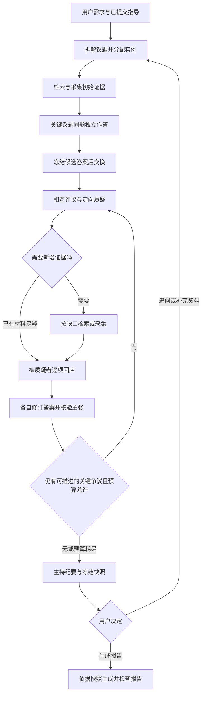

# 基于证据的多智能体辩论与人机协同报告生成设计

本文是 `/discussion` 工作台的目标设计。当前 Demo 已实现同题双实例独立作答、互审、补证、各自修订、主张核验、轮次暂停及报告快照；各条设计不全代表已交付功能，实际范围与尚未实现部分见 [DISCUSSION_DEMO.md](DISCUSSION_DEMO.md) 的“辩论工作台升级”。目标是让报告中的结论能够追溯到材料、质疑和修订；不宣称已经量化提高报告质量。

2026-11-18 调度更新：按用户最新要求，新轮次中每个媒体观点议题、舆情分析议题固定启用两个独立实例，首个交锋必须双向质询具体主张并逐项回应修订；来源整理和统计汇总也适用。事实研究仍按任务选择实例数。本文下述按需增减规则在这两个角色上以本条更新为准；历史冻结计划保持原安排。实际实现与复核入口见 [DISCUSSION_DEMO.md](DISCUSSION_DEMO.md) 的“媒体与舆情固定双实例质询”。

沿用 Flask、SQLite、SSE、现有模型配置及 ReportEngine。业务聚焦事件与舆情分析；不设置政策分析模块，不展示模型内部思维链。本文承接用户提出的辩论式协作要求；已有运行说明见 [DISCUSSION_DEMO.md](DISCUSSION_DEMO.md)。

## 1. 文献依据与设计边界

| 文献 | 可借鉴机制 | 本项目的设计选择与边界 |
| --- | --- | --- |
| [Co-STORM，Jiang 等，EMNLP 2024](https://arxiv.org/abs/2408.15232) | 用户旁观并引导智能体讨论，组织信息并生成报告 | 保留用户决策节点，以争议议题组织交互；不能将人机论坛本身宣称为新机制 |
| [Multiagent Debate，Du 等，ICML 2024](https://arxiv.org/abs/2305.14325) | 多个模型实例独立提出答案，互相批评并修订 | 同功能可以有多个实例；该论文的推理与事实性结果不直接证明舆情报告收益 |
| [MAD，Liang 等，EMNLP 2024](https://arxiv.org/abs/2305.19118) | 辩论管理、不同论点及自适应停止 | 不强制正反立场，允许认可对方；主持意见不是事实证明 |
| [STORM，Shao 等，NAACL 2024](https://arxiv.org/abs/2402.14207) | 多视角提问、联网取证、组织提纲和长文 | 将质疑转为有明确目的的检索，再写报告；多视角问答与对抗辩论应区分 |
| [AutoGen，Wu 等，2023 年预印本](https://arxiv.org/abs/2308.08155) | 多智能体对话、工具使用与人工输入 | 参考交互协议，在现有服务实现，不以更换框架为前提 |
| [ALCE，Gao 等，EMNLP 2023](https://arxiv.org/abs/2305.14627) | 正确性、引用支持与引用完整性评价 | 检查具体主张是否有支持；引用存在性与语义支持程度分别检验 |

以下的主张账本、任务协议和预算数值属于本项目设计，不能写成上述论文已经验证的结论。引用核验不是现实世界真伪的充分判据。

## 2. 现有代码与需要改变的行为

| 位置 | 核对到的行为 | 所需改变 |
| --- | --- | --- |
| [discussion/service.py](discussion/service.py) 的 `_tasks` | 最多三个分析任务，每角色去重 | 拆分 `group` 和 `agent_id`，允许同组不同实例处理同一议题 |
| 同文件 `_run_round` | 并行分析后，一次核验及最多一次定向回应 | 引入议题、质疑队列和多次有条件交锋，回应前允许补证 |
| 同文件的 `current` 合并 | 按 `role` 保留最后一张卡片 | 按实例和主张版本保存，禁止同组实例相互覆盖 |
| 同文件 `_card` | 每次检索十个片段，同时输入其他卡片，引用仅允许来自这十个片段 | 交锋上下文先附上被质疑主张的原始证据，再召回补充材料 |
| 同文件的反馈处理 | 有关联卡片即可能标为 answered | 分别记录已回应、已解决、部分解决和缺资料，不以发言代替落实 |
| [discussion/providers.py](discussion/providers.py) | 搜索词拼接整段时间说明；报告取卡片引用材料 | 将关键词与日期参数分离；报告输入改成主张账本及证据闭包 |
| [discussion/store.py](discussion/store.py) | SQLite 保存会议 JSON 和事件，支持原子修改与中断恢复 | 增加可兼容字段、执行检查点及任务幂等标识 |
| [static/discussion/workspace.js](static/discussion/workspace.js) | 按轮次展示角色卡片，证据仅显示前六十项 | 按议题串联交锋，增加来源筛选与分页，沿用简洁引用按钮 |

核验任务的上下文中可能出现“看到其他卡片的引用编号，却没有收到对应原文”的情况。这是代码中的上下文契约缺口；既有失败的实际模型原文未在本次设计中复核，不能断言它解释了全部历史失败。

## 3. 功能组、实例与发言权

保留事实研究、媒体观点、舆情分析、交叉核验和主持协调五个功能组。ReportEngine 承担报告编写。搜索、平台爬虫、OCR、图片理解和统计计算作为工具能力，按任务调用。

| 功能组 | 主要责任 | 启用条件 |
| --- | --- | --- |
| 事实研究 | 原始材料、身份、事件时间线与事实边界 | 议题涉及事实判断时启用 |
| 媒体观点 | 报道焦点、观点归属与来源差异 | 用户需要比较报道或解释传播叙事时启用 |
| 舆情分析 | 评论主题、情绪、表达对象及样本局限 | 有真实评论且问题需要样本分析时启用 |
| 交叉核验 | 具体主张的证据支持、逻辑边界与统计口径 | 对进入报告的重要主张、未解决冲突开展检查 |
| 主持协调 | 维护问题清单、路由发言、调度工具与形成纪要 | 每个轮次一个协调实例，等待用户时不调用模型 |

不设置固定总人数或每组固定实例数。协调器先按议题启用最少必要的分析角色，再通过现有角色的互审发起辩论。事实角色可以质疑舆情结论的适用范围，舆情角色也可以质疑媒体角色对公众态度的推断。同一个实例既可以提出主张，也可以质疑其他主张。

### 3.1 任务路由与实例增减

协调器对每个待处理问题先检查以下条件，决策及理由写入任务计划：

1. 若只是缺少资料，让现有负责实例调用检索或采集工具；增加发言者不会自动填补证据缺口。
2. 若是已有材料的解释或逻辑争议，指派具备相应能力的其他现有实例质疑，并让主张作者回应。
3. 若问题需要尚未启用的功能，启用相应功能组的实例。例如需要评论分析时启用舆情角色。
4. 对第 3.3 节定义的关键议题，先安排多个实例回答同一问题；已有成员能满足独立作答条件时复用，否则创建临时实例。其他任务只有在现有团队无法覆盖明确的独立分析路径，或存在可并行且上下文差异较大的子问题时，才增加同功能实例。
5. 临时实例完成指定交付物后转为待命，保存全部记录；只在新材料影响其结论时再次调用。

新增同功能实例的具体触发例子包括：两个来源对关键时间给出冲突说法，需要分别追溯原始材料；关键推断经一次补证仍有实质分歧，需要未读双方结论的独立复核；评论样本的分层设计超出当前任务范围，需要专门检查统计方法。单纯增加平台、任务失败、出现普通意见差异或材料数量变多，不自动触发新增实例。

独立复核实例先收到问题和原始证据，提交初始判断后再看到双方主张，以减少跟随已有结论；它仍与原实例共享模型偏差，不能被视为独立专家证明。新增实例任务须写清目标问题、为何无法由现有成员完成、新增视角、允许工具、交付物、退出条件及预计调用预算。程序验证字段和预算后才执行。

### 3.2 发言权与效能约束

主持人按“用户指定且未解决的问题、影响报告核心结论的冲突、一般覆盖缺口”的优先级调度。只有提出新主张、具体质疑、补证回应或修订才产生正式发言；纯重复内容合并展示并保留原始记录。初始无依赖任务并行，后续按质疑定向回应，不让所有实例轮流评论全部内容。

每个实例拥有独立任务说明、上下文和记录，可以共用 `qwen3.7-plus`。实例增加、继续调用和退出都应能解释其对当前议题的用途。工具返回空结果优先调整检索或报告缺口，不通过不断生成新实例掩盖数据不可用。

效能需要同时考察有效证据支持、用户要求落实和修订结果，以及模型调用、token、时延与重复发言。主张修订次数也不能单独作为收益，因为正确结论不必改变。初版采用明确规则和记录支持调度，积累案例后再评估是否需要学习型调度器；本方案不宣称已有全局最优人数或调度策略。

### 3.3 同题独立作答、互评与分别修订

将 Multiagent Debate 的同题多实例机制明确设为关键议题的默认处理路径。关键议题指直接影响报告摘要或核心结论、存在相互冲突的来源、需要解释性推断，或由用户指定要求辩论的问题。判定理由写入议程，可由用户调整。单纯摘录明确日期、去重或计算计数继续使用单实例或程序工具。

每个关键议题建议先安排两个合格实例，必要且预算允许时再加入第三个独立分析实例。该数量是工程起始设置，不是每个功能组的配额，也不是最优性结论。实例可以来自同一功能组或不同功能组，但必须回答完全相同的核心问题；“一个分析事实、另一个分析情感”不算同题独立作答。

| 步骤 | 输入与交互约束 | 持久化结果 |
| --- | --- | --- |
| 同题分发 | 相同问题、范围、输出要求和共同证据版本；可以提供不同的审查关注点，但不指定必须得出的结论 | 候选任务及独立性标记 |
| 独立作答 | 隔离模型上下文，不读取其他参与者本轮答案、批评或主持的预设结论 | 各自答案 v1、可检查的分析摘要、原子主张、证据和不确定性 |
| 阶段屏障 | 等待本组初始作答完成、失败或超时后才向参与者发布候选答案集合；不将先完成者的答案传给尚未完成者 | 已冻结的初始候选集及失败记录 |
| 相互评议 | 每位参与者检查至少一份非本人答案，指出认可内容、具体异议、证据缺口与对自身答案的启发 | 指向答案和主张版本的评议与质疑 |
| 补证 | 将有效质疑转成检索或采集任务，共享通过检查的新证据版本；重复请求合并 | 新增材料、工具运行及覆盖缺口 |
| 分别修订 | 每位作者收到同一版候选集、相关评议和补证材料，分别生成 v2；本阶段不读取其他人的未完成 v2 | 修订答案、逐项回应、维持或改变的主张及理由 |
| 证据核验 | 检查各修订版本的引用支持、数字与逻辑边界；仍有实质分歧才进入下一次交锋 | 核验记录、未解决分歧和可采用主张 |
| 主持综合 | 根据核验后的主张组织结论，保留未解决问题与不同解释 | 纪要、主张到报告的映射及用户决策节点 |

两个实例互评彼此；三个及以上实例采用有覆盖检查的定向评议安排，使每份答案获得至少一位其他实例的审查，不强制全员两两评论。参与者可以认可全部有依据的内容，不必编造反对意见。核验不只检查分歧点，还要抽查双方共同采用的关键依据，防止错误共识被跳过。

只有一个初始答案有效时，标记为单答案降级，不能展示“已完成多实例辩论”。预算允许时重新安排未接触该答案的实例独立作答；否则保留该限制交还用户。关键问题无可用材料时，各实例可以明确回答证据不足，并转为补证任务，不能为完成流程虚构不同立场。

同一底座模型的多个实例通过不同请求及隔离消息上下文实现，不要求部署多个模型服务。允许配置不同底座，但不按品牌或自报置信度决定胜负。各答案的来源与支持关系才是综合依据。所谓“独立”仅指初始信息隔离，不能据此假定其错误在统计上独立。

主持人可以组合不同答案中各自有证据支持的部分，也可以保留互不相容的解释；不把简单多数投票或全文拼接作为综合策略。若改写导致范围扩大或新增推断，必须产生新的待核验主张。

## 4. 双层轮次与工作状态

外层“研讨轮次”由用户启动，冻结本轮指导、材料版本及任务边界。内层“交锋回合”由协调器管理，完成具体争议的质疑、补证和回应。用户发一条消息不自动启动付费分析。

建议内部阶段为 `planning → collecting → proposing → exchanging → challenging → supplementing/replying → revising → verifying → summarizing → waiting`，程序只执行已定义的转换。`exchanging` 只能发生在候选集冻结后，`revising` 读取冻结的同一回合输入。非关键的单实例任务可以跳过交换阶段，并在任务模式中明确标记。前端可继续保留现有 `running` 总状态，以 `stage` 显示子阶段。

初始分析采用同一证据库版本和明确的共同问题，各实例先不读取本轮其他实例的答案。可按视角检索不同补充片段，但共同事实包一致，避免人为制造信息不对称。上一轮已经公开的结论可以共享，同时标记待复核项。

## 5. 主张与定向质疑协议

主张是可以被支持、反驳或限定的一条陈述。长段落必须拆分，区分事实、归属明确的观点、统计结论和解释性判断。模型输出公开论证摘要及依据，不输出内部思维链。

| 对象 | 必要字段 |
| --- | --- |
| 议题 `issue` | ID、用户问题、范围、关联反馈、负责实例、完成条件、当前状态 |
| 实例 `agent` | ID、功能组、分析视角、模型配置引用、可用工具、上下文版本 |
| 候选答案 `proposal` | ID、议题、作者实例、答案版本、前一版本、问题版本、证据版本、所属交锋回合、主张列表、独立作答或降级标记 |
| 相互评议 `peer_review` | ID、评议者、目标候选及版本、认可项、质疑 ID、对自身答案的修订建议 |
| 主张 `claim` | ID、版本、提出实例、类型、文本、适用范围、支持证据、反对证据、来源归属 |
| 质疑 `challenge` | ID、目标主张及版本、提出者、类型、具体问题、判断依据、解决条件、接收实例 |
| 回应 `reply` | 质疑 ID、目标版本、回应要点、新证据、修订动作、仍缺材料 |
| 核验 `verification` | 主张版本、核验者、支持/反驳/不足的理由、引用位置、统计检查、核验方法 |

质疑类型包括证据不足、来源冲突、时间冲突、样本偏差、统计错误、过度推断、替代解释和用户需求未回答。质疑不一定有反证，但必须指向具体主张并说明缺口。仅有“我不同意”“建议更全面”不进入正式交锋队列。

对重要主张指派一个具备相关能力、且不是主张作者的现有实例互审；是否同组由问题性质决定。例如事实实例质疑“媒体报道等于官方认定”，舆情实例质疑“发帖量等于公众支持率”。无有效质疑时记录审查结果，不强制争论。

优先级按明确规则排序：用户指定且未解决的问题优先，其次是影响摘要或核心结论的来源冲突、统计错误，再处理一般覆盖缺口。用目标主张、版本和质疑类型去重；语义重复合并时保留原始记录及合并理由。

被质疑者逐项选择维持、限定范围、修订或撤回。维持须指明支持依据；修订建立新版本并解释变化，不能覆盖旧文本。提出质疑者检查回应是否满足解决条件；核验实例处理双方仍有分歧的材料。主持人不能把未解决质疑改写成共识。

主张的流程状态和证据状态分开记录。流程状态可以是待讨论、讨论中、已回应、已关闭；证据状态可以是有支持、部分支持、证据不足、证据冲突、已被反驳。撤回单独记录。关闭讨论或用户要求出报告，都不改变证据状态。

## 6. 由质疑驱动的 RAG 与按需采集

补证请求必须关联议题或质疑，并携带目标事实、关键词、来源类型、时间范围、已有材料及完成条件。先检索会议库；缺少材料时才调用外部搜索或爬虫。

搜索保留博查、安思派适配器，路由选择和失败情况写入记录；不声称已经同时调用两者。网站范围由问题决定，平台直接采集范围取决于已验证的适配器。对尚未接入的平台，返回明确能力状态。

关键词不拼接整段时间说明，日期通过提供方支持的参数传递；无日期参数能力时按返回日期筛选，并将未知日期单独标记。入库前检查与事件主体、问题的相关性，不将“HTTP 成功”视为“证据有效”。拒收记录保留原因以便排查。

新增证据先进入轮次暂存区，完成去重、来源和相关性检查后发布新证据版本。发言记录实际使用的版本；只重新打开被新增材料影响的主张。批次更新存在阶段边界，同一次交锋中的实例不会读取不确定的混合材料。

不再用固定帖子条数作为“研究充分”的标准。每个采集任务按缺口分批执行，保存分页游标和实际覆盖范围。完成条件可以是找到原始通报、补齐指定平台时间段可访问结果、连续批次无新增相关材料或平台无下一页。新增信息变少只说明边际收益下降，不能证明样本代表性。

采集仍受请求间隔、平台返回、取消、运行时间和费用预算控制；达到运行预算则保存进度并暂停，不能自动宣布研究完成。大型评论集分批分类，只将统计与相关样本提供给辩论角色，避免全部装入上下文。

每次回应使用“目标主张原文＋质疑＋原引用片段＋新增相关片段＋统计版本”。必须带入原引用的实际片段。超过上下文预算时拆分任务，禁止仅传编号或静默截掉关键证据。

引用检查分两层：程序检查编号确属当前会议、当前任务证据清单和冻结版本；核验角色检查片段是否支持陈述。编号错误可在有限预算内要求原实例修复；仍失败则标记结果不可采纳，不能扩大白名单掩盖错误。

图像证据作为扩展工具接入：保存原图、哈希、原帖、采集时间，OCR 和视觉描述分别保存为派生材料。模型分析必须区分“截图声称某事”与“已确认某事”。共用模型是否具备视觉能力需实际验证。图片处理失败时保留附件，不编造识别内容。

## 7. 主持收束、预算与异常处理

停止辩论的条件是任务状态与证据进展，不是发言数量或赞成人数。某议题满足以下任一条件即退出本次自动交锋：有效质疑已处理；继续所需材料不可获得；重复交锋没有新增依据或实质修订；用户停止；运行预算耗尽。

建议起始配置为每议题最多两次交锋，可由用户调整。单轮同时讨论的议题、模型调用次数、输入输出 token、采集时长均设运行预算；这些数值是工程配置，不是质量阈值。预算不足的议题进入下轮建议，不能静默丢弃。

调用预算按实际任务图计算：规划调用＋已启用实例的初始分析＋质疑与回应＋必要核验＋主持汇总，另计检索筛选、评论分类、图片理解、修复及报告调用。现有成员能解决的问题不重复生成同功能实例；同批证据只做一次可复用的预处理。实际费用按调用日志和模型价格计算。

主持纪要逐个议题说明当前结论、依据、主要修订、未解决分歧、失败任务及下一步选项。至少有一个有效分析结果且主持汇总完成，才能形成完整轮次快照。部分任务失败可形成带缺口的快照；主持失败或全部分析失败则不能生成新的完整快照。

任务取消与预算暂停采用安全边界：停止派发新任务，等待或终止可取消调用，保存完成结果，并将过期返回排除。用户若要求立即出报告，使用最近完整快照；当前轮尚无完整快照时先收束已有有效结果，成功形成快照后再生成。

进程重启后标记中断，不自动重发付费调用。重试从用户确认的检查点继续，保存独立 attempt，复用有效证据和已完成分类，不把新尝试覆盖成旧尝试成功。

## 8. 用户介入与界面

左侧显示功能组、组内实例、议题和任务状态。中间论坛按议题展示主张、质疑、回应与修订，不只按时间堆叠独立卡片。右侧显示当前结论、证据状态、争议和用户指导落实情况。

每条主张提供“追问这条结论”“查看证据”“查看修订”入口。质疑卡片显示针对哪句话，回应卡片显示是否补了材料、是否改变结论。原始证据编号隐藏在内部，以“来源 1”等标签呈现；来源列表支持类型和平台筛选及分页。

关键议题额外展示“独立答案 → 相互评议 → 各自修订 → 综合结论”路径。桌面可并排比较初始答案，窄屏改为页签；修订视图标出新增证据、收窄表述和撤回内容。用户可以核对不同实例是否确实分别作答，不能把主持人的一段总结拆成多张智能体卡片冒充辩论。

用户可以向全体、功能组、具体实例或具体主张发言。默认将运行中的新消息标为下一轮处理，保持已承诺的轮次冻结语义。若用户明确要求本轮介入，提供“阶段结束后应用指导”：到下一个安全边界冻结新指令版本，将受影响任务重新安排，界面说明哪些结果需要复核。首个实现版本可先保留下一轮处理，再增加阶段介入。

用户反馈记录已接收、已分配、已回应、已解决、部分解决、缺资料及用户关闭。已回应不能自动升级为已解决；判断依据包括用户的具体要求、任务交付物和核验结果。用户关闭代表不再追问，不代表确认事实。

用户的事实性纠正进入待核查材料，要求附来源或通过检索核实。用户可以决定分析范围和报告时机，但不能通过指令让无证据主张变成已核实事实。

## 9. 报告快照与引用闭包

报告输入固定为用户选定轮次的议题、主张版本、交锋记录、反馈处理、核验结果、统计版本、证据版本和局限。报告应覆盖仍然重要的反对证据，不能只选支持方引用。

有支持的主张在适用范围内表述；部分支持的主张采用限定语；证据冲突的主张说明来源差异；证据不足的主张列为待核实；撤回或已被反驳的主张不作为事实性结论。若有必要解释纠错过程，应明确其撤回状态。

ReportEngine 负责组织文稿，不在写作时默默添加新事实。写作发现材料不足，返回结构化缺口交由下一轮讨论。生成后检查主张覆盖、已撤回内容是否复现、数字是否匹配统计版本、引用是否支持相邻陈述。语义核验可能出错，其结果与人工反馈均保留。

同一冻结快照的旧报告不会被后续补证改写。仅在新快照上形成新版本。摘要、正文和来源目录必须使用同一份主张版本集合。

## 10. 工程接口与数据兼容

建议先在现有会议 JSON 中增加 `schema_version`、`agents`、`issues`、`proposals`、`peer_reviews`、`claims`、`claim_versions`、`challenges`、`replies`、`verifications`、`tool_runs` 和 `budgets`。任务增加 `agent_id`、`depends_on`、`claim_version`、`input_revision`、`attempt`，实际执行状态由程序控制。独立作答任务还需记录问题版本、共同证据版本、可见消息清单和候选集版本，用于验证上下文隔离；不记录模型内部思维链。

首版沿用 SQLite 原子更新与 SSE 持久事件。记录规模增长后再拆独立表，图片文件和大批评论不直接反复装入网页状态。公共 API 仅返回当前页面所需字段，评论和证据按页读取。

| 接口改造提案 | 目的 |
| --- | --- |
| 现有 `POST /api/discussions/{id}/rounds` 增加辩论配置及指令版本 | 开启外层轮次，保留 expected_round 并发校验 |
| 现有消息接口增加 target_agent、target_claim、apply_at | 追踪用户针对哪条观点发言，何时生效 |
| `GET /api/discussions/{id}/issues/{issue_id}` | 返回议题下的主张与交锋链 |
| `GET /api/discussions/{id}/evidence` 增加分页及来源过滤 | 避免评论遮挡网页和图片来源 |
| `POST /api/discussions/{id}/rounds/{n}/stop` | 请求在安全边界停止新工作并收束 |
| `POST /api/discussions/{id}/tasks/{task_id}/retry` | 显式重试失败任务并记录新 attempt |

SSE 增加 issue_created、proposal_submitted、proposal_set_frozen、peer_review_posted、proposal_revised、claim_proposed、challenge_opened、evidence_added、reply_posted、claim_revised、verification_completed、round_paused。事件仅引用已提交的记录；任务结果与对应事件在同一事务持久化。网页向用户展示初始结果不代表这些结果已进入其他实例的模型上下文，服务端需独立控制消息可见范围。

保留会议级互斥锁和 operation 标识。任务幂等键由会议、轮次、实例、阶段、目标主张版本、attempt 组成；并发回应使用目标版本检查，过期结果标记待重新核对。每个平台仍有独立采集互斥，多个智能体提出的相同检索请求合并后共享结果。

可从 `service.py` 提取 `debate.py` 负责调度、`claims.py` 负责主张版本与质疑、`evidence_context.py` 负责证据包。继续复用 provider、crawler 和 report 适配层，不在本次设计中引入新的分布式队列或外部向量数据库。

旧会议没有主张账本时按旧模式只读展示。继续研讨时可由适配器从旧卡片提取候选主张，标记为旧材料导入、待核验；不能虚构它经历过的新辩论。已有快照和报告保留原结构和内容。

## 11. 交锋示例

以下数字和语句均为虚构机制示例，不代表裴轶事件的真实判断。

1. 舆情分析实例提出：“当前样本负面情绪占七成，因此公众普遍反对当事人。”
2. 已有核验实例针对该主张质疑：“样本集中在热门帖子；情绪类别不等于针对当事人的立场。请给出平台和时间覆盖，并限定结论。”
3. 主持将问题分成统计复核和覆盖补充，由现有舆情实例调用统计及平台采集工具。
4. 工具返回更多不同帖子的样本，程序建立新统计版本；失败平台记录缺口。
5. 舆情分析实例回应：“新增样本没有消除非随机抽样问题。撤回整体公众判断，改为当前样本以负面表达为主，情绪对象尚需另外标注。”
6. 已有事实研究实例补充：“某些负面评论针对报道方式，不能一并计为反对当事人。”
7. 核验实例确认比例与统计版本一致，但不能据此证明公众总体立场。
8. 主持记录撤回的泛化结论、当前有限结论和剩余缺口，等待用户决定是否继续做对象标注。

报告采用第五步修订后的范围和第七步局限，保留所用统计与证据来源，不重新使用第一步被撤回的判断。

## 12. 实施与验收

建议按以下顺序推进，每一步都有可独立演示的结果：

1. 修复检索相关性、时间参数、证据展示分页和引用上下文，避免用无关材料驱动更多讨论。
2. 拆分功能组与实例，增加同题独立候选、交换屏障、相互评议和分别修订，验证同组实例不互相覆盖、初始答案不泄漏到其他实例输入。
3. 接入定向质疑、回应、补证及有限回合，贯通“质疑引发新增材料”的实际工具调用。
4. 增加用户定向指导、阶段边界处理、暂停及恢复，并改造议题式论坛。
5. 接通主张快照到报告的映射和核验，再扩展图片工具与更大规模分页采集。

验收包含：简单议题不强制启用所有组；已有实例可交叉质疑；明确独立复核需求能触发同功能临时实例；新增实例有退出条件；质疑明确指向主张版本；回应能实际增加相关证据；撤回有历史且报告不再引用为事实；用户指导有任务和结果对应；无新证据时不会无限辩论；平台或模型失败能保留缺口；中断不自动重发调用；跨会议证据无法引用；旧快照不变；无评论不产生情感比例。

方案暂不增加实验看板。验证机制收益时，优先比较引用支持、必要事实覆盖、用户要求落实和错误主张修订，并记录调用成本与时延。人工核验或语义模型评估需注明方法；不能把智能体赞同数、发言长度或单一模型自评分当成报告质量。

同题辩论专项验收：至少两个有效初始答案对应同一问题和共同证据版本；初始上下文不含彼此答案；每份答案有非作者的评议；各作者分别提交修订版本或维持理由；工具补证实际入库；单答案降级清晰可见；综合结论能追溯到主张和证据，既不丢失少数方的有效证据，也不因意见一致跳过核验。

## 13. 取舍

定向辩论比全员互聊更容易追踪责任与控制调用，但可能漏掉未被路由的观点，因此保留其他实例主动提交有具体依据的质疑入口。固定阶段比自由对话容易恢复，却会增加等待；初始分析和不相依的补证任务可并行。

共用模型配置便于本地落地，但存在共同偏差。优先用证据来源差异、独立初始分析和可检查的统计降低重复观点，再根据实际需要配置不同模型。自动语义核验仍可能误判，用户需要能够打开原文并提出异议。

本方案的可验证设计重点是用户指导、质疑、补证、主张修订与报告之间的可追踪关系。相关机制已有论文基础，是否构成研究创新以及是否改善报告结果，仍需更完整的相关工作比较和实证验证。
