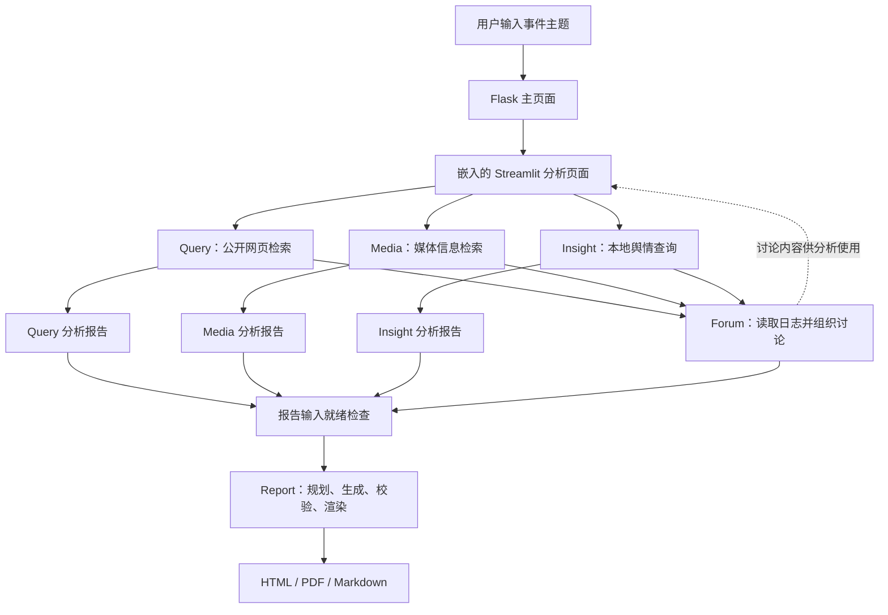
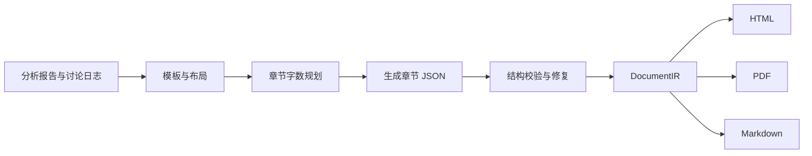

# 项目功能结构与毕设优化路线

该项目以多 Agent 舆情分析和报告生成为核心，包含联网检索、本地数据查询、论坛讨论、结构化报告渲染，以及独立的会话与采集接口。适合在现有工程上研究证据质量、任务可靠性和报告可追溯性。建议先完成一个可重复运行的分析闭环，再选择两项可测量的优化，避免同时扩展所有模块。

本文依据本地代码梳理。功能实现与运行验证分开描述；运行状态采用 2026-11-16 本轮检查的快照，不代表服务始终在线。后半部分为建议方案，尚未实施。

## 1. 入口与整体架构

`app.py` 是 Flask 后端入口，负责页面路由、配置接口、进程管理和报告接口挂载。主页面在 `templates/index.html`，三个分析页面在 `SingleEngineApp/`，由 Streamlit 提供。

项目存在两套服务入口，其功能不能直接视为已经在当前页面中统一接通。

| 入口 | 主要职责 | 本地使用情况 | 代码 |
| --- | --- | --- | --- |
| Flask 主站 | 配置、启动分析组件、嵌入分析页面、论坛日志、报告展示与导出 | 当前使用的主入口，端口 5000 | [app.py](app.py)、[主页面](templates/index.html) |
| Streamlit 分析组件 | 接收主题，运行各自的分析流程，展示过程并保存报告 | Insight、Media、Query 分别使用 8501、8502、8503 | [SingleEngineApp](SingleEngineApp/) |
| FastAPI 扩展服务 | 事件分析、会话、任务状态、流式输出、采集导入、事件统计 | 检查时默认端口 8000 未监听，需独立部署验证 | [fastapi_integration.py](fastapi_integration.py) |

主页面通过设置 iframe URL，把 `query` 和 `auto_search=true` 传入 Streamlit。`app.py` 中另有 `/api/search`，转发目标为 8601、8602、8603；检查时这几个端口未监听。它与当前页面路径不一致，后续应确认用途并统一，不能仅据此认定页面主流程不可用。

## 2. 核心功能模块

### 2.1 联网检索与分析

| 模块 | 已有功能 | 输入与输出 | 边界与代码 |
| --- | --- | --- | --- |
| QueryEngine | 生成分析结构、网页检索、分段总结、多轮反思与补充检索 | 主题 → 搜索证据 → 分析报告与状态文件 | [agent.py](QueryEngine/agent.py)、[搜索适配层](QueryEngine/tools/web_search.py) |
| MediaEngine | 通过搜索提供方获取媒体信息并分析 | 主题 → 检索结果 → 媒体侧报告 | [agent.py](MediaEngine/agent.py)、[搜索工具](MediaEngine/tools/search.py) |
| InsightEngine | 查询本地帖子、评论和热度，按主题或平台汇总，提供情感分析接口 | 主题 + 数据库记录 → 本地舆情报告 | [数据库搜索](InsightEngine/tools/search.py)、[情感分析](InsightEngine/tools/sentiment_analyzer.py) |
| ForumEngine | 监控三个引擎日志，积累发言，调用主持模型组织讨论 | 分析日志 → 论坛讨论日志 → 供引擎读取 | [monitor.py](ForumEngine/monitor.py) |

当前 Query 使用博查 Web Search，Media 使用安思派，真实检索验证记录见 [本地配置说明](LOCAL_SETUP.md)。搜索服务负责提供信息，大模型负责分析和生成，两者不是同一类 API。

MediaEngine 的当前已核对路径主要处理网页文本。模型客户端传入的是文本消息，不能据模块名称就认定已完成图片识别或视频理解。相关实现见 [模型客户端](MediaEngine/llms/base.py)。

Insight 的主搜索实现直接使用 `dmPython` 访问达梦数据库；目录中的其他数据库工具仍包含 MySQL/PostgreSQL 实现。部署与开发应以实际调用路径为准，不能只按通用配置示例判断数据库类型。

情感分析代码包含五级标签、延迟加载、本地模型查找与下载回退。模型加载成功、标签适合当前事件、预测准确率达标是三个不同问题，目前尚未完成这些验证。尤其需要区分“负面情绪”与“对某一方持反对立场”。

### 2.2 报告生成与导出

[ReportEngine](ReportEngine/agent.py) 包含完整的结构化生成流程：模板选择、布局设计、字数规划、章节生成、校验与修复、文档合并、格式渲染。中间文档结构称为 DocumentIR，用于减少正文生成与输出格式之间的耦合。

关键代码为 [模板解析](ReportEngine/core/template_parser.py)、[IR 定义](ReportEngine/ir/schema.py)、[IR 校验](ReportEngine/ir/validator.py) 和 [渲染器](ReportEngine/renderers/)。Flask 报告接口由 [flask_interface.py](ReportEngine/flask_interface.py) 提供，包含状态、生成、进度、结果及取消等能力。

当前 Flask 报告入口的就绪条件是：三个分析目录相对基准均新增 Markdown 文件，并且论坛日志存在。满足后按各目录文件修改时间选取最新报告。代码见 `ReportEngine/agent.py` 的 `FileCountBaseline`、`check_input_files` 与 `load_input_files`。

这个规则检查了文件数量，但没有在该选择步骤校验三个文件属于同一个主题或任务。因此存在交叉任务取错材料的风险，仍需用并发或连续任务测试复现。服务重启后基准重新初始化，也应纳入就绪判断的测试场景。

报告字数规划提示词要求总字数约 40000 字、上下浮动 5%，见 [prompts.py](ReportEngine/prompts/prompts.py)。这是提示词目标，不代表每次输出必然达到该长度。可将固定篇幅改为由报告类型、证据数量和用户需求决定的预算，并测量质量、耗时和费用变化。

### 2.3 会话与事件分析扩展

FastAPI 的 `/api/v1/analysis/event` 与 `/api/v1/analysis/event2` 提供不同分析路径；`event2` 对接 `singleAgent`，包含讨论、报告生成和修订等流程。会话状态可保存到 `logs/sessions`。这些代码已经存在，不能在毕设中把“增加会话”或“增加模板”直接作为全新贡献。

| 能力 | 实现位置 | 接通时需要确认 |
| --- | --- | --- |
| 讨论、生成、修订模式 | [pipeline.py](singleAgent/pipeline.py)、[报告流程](singleAgent/report_pipeline.py) | 模式切换、前端交互与输入约定 |
| 会话历史及持久化 | [session_store.py](singleAgent/session_store.py) | 会话隔离、恢复与容量限制 |
| 检索规划与来源引用 | [search_planner.py](singleAgent/search_planner.py)、[citations.py](singleAgent/citations.py) | 引用是否真实支持对应结论 |
| 知识库与数据库检索 | [knowledge_base.py](singleAgent/knowledge_base.py)、[event2_retrieval.py](singleAgent/event2_retrieval.py) | 外部接口、业务表与授权配置 |
| 模板管理 | [session_templates_api.py](singleAgent/session_templates_api.py)、[report_templates](report_templates/) | 模板版本、选择与恢复规则 |
| 流式输出与取消 | [sse.py](singleAgent/sse.py)、[cancellation.py](singleAgent/cancellation.py) | 取消能否传播到正在运行的操作 |

FastAPI 的部分入口仍调用 `check_mock_search_api()` 作为前置检查。需要核对它与实际搜索部署的关系，不能假定 Flask 中博查配置成功就代表这套入口也能直接运行。

### 2.4 采集、数据导入与事件统计

| 模块 | 作用 | 验证边界 |
| --- | --- | --- |
| [MindSpider](MindSpider/) | 主题提取、关键词与多平台内容采集 | 有平台采集代码，不代表登录态、网络与写库均已验证 |
| [opinion_crawl](opinion_crawl/) | 按日期或事件组织采集任务、同步与进度查询 | 依赖采集服务与数据库 |
| [crawl_import](crawl_import/) | 上传包含清单与 CSV 的 ZIP，异步导入达梦 | 需验证数据格式、去重与失败恢复 |
| [event_sync](event_sync/) | 外部事件同步为主题，并按配置触发采集 | 存在独立配置，需防止与根目录配置不一致 |
| [event_report](event_report/) | 事件列表对接、影响评估、敏感性分析 | 依赖外部事件接口与业务数据，未完成端到端验证 |
| [mcp_server_dm](mcp_server_dm/) | 提供数据库结构与检索桥接 | 需验证数据库连接和实际可访问表 |
| [GraphRAG](ReportEngine/graphrag/) | 报告侧图谱增强，主站提供图谱相关接口 | 当前配置关闭，实际质量与收益未验证 |

## 3. 当前可用状态与阻塞点

下表是 2026-11-16 检查记录，后续开发应重新运行健康检查。进程存活只说明服务启动，不能代表分析任务成功。

| 项目 | 检查结果 | 对毕设开发的影响 |
| --- | --- | --- |
| Flask 与三个 Streamlit 服务 | 5000、8501、8502、8503 监听；状态接口显示组件运行 | 可以继续在本地主页面开发 |
| 模型配置与调用 | 七个相关模块配置为 `qwen3.7-plus`；已验证 Query 普通调用和 Report 流式调用 | 其他业务链路仍需各自验证，配置不等于全部调用成功 |
| 联网检索 | 博查和安思派已返回真实网页结果 | 可进行公开资料分析 |
| 本地数据库 | 127.0.0.1:5236 未监听，之前连接被拒绝 | Insight 无法完成依赖本地库的分析 |
| 报告入口 | 已初始化，`engines_ready=false`，三个报告目录均无新增文件 | 主页面完整报告链路尚未通过 |
| 俄乌冲突报告 | 已有公开资料版 HTML、PDF、Markdown | 是独立报告任务，不是三个引擎协同跑通的证据 |
| FastAPI | 默认端口 8000 未监听 | 扩展功能需独立启动与验收 |
| 情感模型、采集、GraphRAG | 未完成运行验证；GraphRAG 配置关闭 | 不宜直接写成已验收功能 |

本地运行、搜索与模型配置由 [LOCAL_SETUP.md](LOCAL_SETUP.md) 维护。公开资料版报告的输入和生成方式也在该文档记录。

## 4. 建议的毕设范围

推荐暂定题目：**《基于多源证据融合与可追溯生成的舆情分析系统设计与实现》**。

这个范围能复用现有分析与渲染模块，把工作集中在证据质量和任务可靠性。是否满足学校对创新的要求，仍应结合导师意见；仅更换模型、换皮界面或开启已有模块，不足以说明方法上的贡献。

如果无法获得真实帖子与评论，题目和结论应明确限定为公开资料事件分析；不要把新闻报道的情绪直接解释为公众情绪分布。

### 4.1 优先完成任务与数据闭环

建议先建立一种确定可用的数据模式：公开网页模式，或已接通数据库的舆情模式。系统应在任务开始前显示可用数据源；缺少本地数据时，应明确限定分析范围。

随后引入统一的 `task_id`，将主题、时间范围、搜索证据、引擎状态、日志和报告关联到同一任务。报告就绪判断基于任务记录，避免依赖全局文件数量和目录最新修改时间。可先用轻量任务表或本地数据库实现；在需要跨进程并发与恢复时再引入专用任务队列。

验收建议：连续分析不同事件时不串材料；单个数据源失败时给出明确状态；重启后能定位任务和产物；取消任务后不会继续错误地标记完成。这些是待验证目标。

### 4.2 核心优化一：证据融合与可追溯报告

建议在搜索返回与模型分析之间加入统一证据层，保留来源 URL、标题、发布时间、采集时间、平台、查询词、正文片段和任务标识。发布时间与采集时间分开存储，避免把旧报道误认为新事件。

先做 URL 归一化和重复内容过滤，再按主题相关性与时间范围排序。报告中的主要事实和数字关联到具体证据片段，用户可以从结论打开原文，并核对数字、单位与日期。证据不足时说明缺口，不要求模型补齐结论。

已有 `singleAgent/citations.py` 可作为复用入口；优化目标是验证“引用支持结论”，并把能力接入当前主链路。代价包括证据存储、引用映射和人工核验工作。若直接引入 GraphRAG，部署和评测成本会更高，建议先完成普通检索与引用的基线。

### 4.3 核心优化二：按数据与预算调度分析

建议根据数据源可用性、事件类型和证据数量选择引擎、反思轮次与报告长度。例如只有公开网页材料时输出公开资料报告；有真实评论样本时再增加本地舆情统计。

对密钥无效、额度不足、超时、数据库不可达和空结果分别处理。模型调用前做必要检查，失败时记录所在步骤与重试条件。报告提供简报与详细版预算，避免所有任务都追求固定长篇输出。

代价是调度规则与质量门槛需要验证。可先实现可解释的规则调度，再考虑模型驱动调度；不能只凭耗时降低就认定优化成功，必须同时检查证据覆盖与报告质量。

### 4.4 配套工程：统一任务页面

建议在现有页面上增加任务列表、阶段状态、失败原因、重试入口、来源查看和历史报告。先统一 API、任务标识和状态约定，再决定是否迁移前端框架。

保留 Flask + Streamlit 的成本较低，适合先验证核心优化。统一到 FastAPI 与独立前端有利于后续产品化，但接口迁移、流式展示和回归验证会占用毕设时间。两条路线应按开发期限选择。

## 5. 实验与评价设计

建议先用 20-30 个事件做试验性评估，覆盖不同事件类型；这是建议样本量，不是已采集数据或统计充分性的保证。保存固定检索快照，统一时间窗口和模型配置，并记录每次实际调用与输出，降低外部搜索变化对比较的干扰。

| 比较内容 | 建议对照 | 评价指标 |
| --- | --- | --- |
| 证据融合 | 当前检索流程 vs 去重、排序与引用校验 | 检索相关性 Precision@k、重复率、引用支持率、无依据断言比例 |
| 自适应调度 | 相同可用数据下固定流程 vs 自适应流程 | 成功率、耗时、Token、实际费用、证据覆盖率 |
| 数据源缺失处理 | 数据库不可用、空结果、搜索超时等受控场景 | 完成率、失败定位准确性、重试与恢复结果 |
| 报告事实质量 | 对主要事实、数字、日期抽样人工审核 | 事实错误率、数字和单位错误率、来源可访问率 |
| 情感分析（可选） | 有标注样本上的基线与改进模型 | Macro-F1、各类召回率、混淆矩阵 |

当前完整三引擎流程未跑通，不能直接作为已有实验结果。应先建立可运行基线；所有变体使用相同证据条件，并把正常场景与故障场景分开统计。

引用支持率应检查原文是否支持对应主张，不能只统计有多少链接。可由两名标注者独立核验部分样本并记录分歧。耗时与费用要与质量共同报告，不能编造提升百分比。

若选择情感方向，可先标注 200-500 条真实评论进行流程验证，再按类别分布与实验需求扩大数据。划分训练与测试时应考虑事件隔离，避免相似评论或同事件信息泄漏；这部分会增加独立的数据建设工作。

## 6. 开发顺序与论文组织

| 顺序 | 交付物 | 完成判据 |
| --- | --- | --- |
| 1. 固定基线 | 环境清单、数据模式、一个完整任务样本 | 从主题输入到报告导出可重复运行 |
| 2. 统一任务 | 任务记录、隔离目录、明确状态与恢复机制 | 连续任务不串数据，失败可定位 |
| 3. 改进证据 | 标准化证据、去重排序、结论引用 | 能按证据核对报告，并完成对比实验 |
| 4. 改进调度 | 数据源选择、动态预算、异常处理 | 相同质量约束下评估耗时与费用 |
| 5. 完成展示与评测 | 任务页面、来源查看、实验记录与论文图表 | 演示与论文结果均可复现 |

论文可按绪论、相关技术、需求与总体设计、证据融合与任务调度方法、系统实现、实验评价、总结组织。保留基于 BettaFish 的来源说明，并明确标出复用模块与本人新增、修改的模块。具体许可证要求以仓库 [LICENSE](LICENSE) 为准。

建议阅读代码的顺序是：[主入口](app.py) → [主页面](templates/index.html) → [Query 页面](SingleEngineApp/query_engine_streamlit_app.py) → [Query Agent](QueryEngine/agent.py) → [报告接口](ReportEngine/flask_interface.py) → [报告 Agent](ReportEngine/agent.py)。确定要整合会话或采集后，再阅读 FastAPI 与对应扩展模块。
